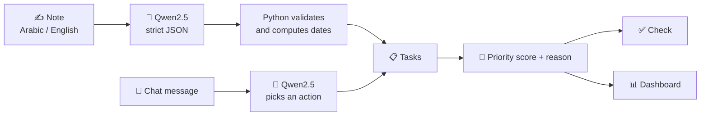

<div align="center">


# ✅ Enjazi | إنجــازي
**مساعدك الذكي لتنظيم مهامك وإنجاز يومك**

*Write naturally. Get organized. Know what matters.*

[](https://colab.research.google.com/github/Saraaha12/Enjazi/blob/main/Enjazi_AI.ipynb)


</div>

---


## The idea

Most to-do apps ask you to work for them: pick a category, set a priority, choose a date, fill a form.
**Enjazi flips that.** Just write the way you'd text a friend:

> *"عندي اختبار الأسبوع الجاي ولازم أخلص المشروع بكرة"*
> *"Remind me to submit the report tomorrow at 3"*

Enjazi reads it, turns it into clear tasks, and tells you what deserves your attention first, and why.

## Run it (free, about 5 minutes the first time)

1. Click **Open in Colab** above.
2. `Runtime → Change runtime type → T4 GPU`.
3. Run the cells from top to bottom (the first run downloads the model, a few minutes).
4. The last cell prints a **public link** (`https://xxxx.gradio.live`). Open it.

The app uses **model: Qwen2.5-3B-Instruct** (open-source). No API key and no database needed. 

## The five pages

| Page | What it is for |
|---|---|
| ✍️ **Add tasks** | Write a free-form note in Arabic, English, or both. Qwen splits it into separate tasks and extracts the **date, time, category, importance and estimated duration**. One-tap examples are provided. |
| 🎯 **Priorities** | A big card answers *"What should I do first?"* with a plain reason (e.g. *"Because it is due tomorrow and it matters"*). All other tasks follow, ranked **Critical / High / Medium / Low**. You can override any priority and the app respects your choice. |
| ✅ **Check** | Tick one or more tasks, then mark them **Done**, **move them to tomorrow**, or **delete** them. Finished tasks are listed underneath. |
| 💬 **Assistant** | Chat in your own words: *"What should I focus on today?"*, *"I have two free hours"*, *"move the project to day after tomorrow"*, *"I finished the report"*, *"Remind me to call Sarah tomorrow at 4"*. Qwen decides the action and the app performs it. |
| 📊 **Dashboard** | Totals, completion rate and progress bar, **workload for the next 7 days**, tasks **by category**, and open tasks **by priority**. It updates the moment you add or finish a task. |

**Language:** use the switch under the banner (English / العربية). The whole interface changes to **one language at a time**, with right-to-left text for Arabic. Your notes are never translated.

## How it works



- **Qwen returns "days from today"**, and Python computes the real date. Small models are weak at calendar math, so this keeps dates reliable. The prompt also includes a "days until each weekday" table.
- **Priority score** = urgency (past / today / tomorrow / this week / later) + importance × 8, mapped to Critical, High, Medium, Low.
- **Never breaks:** if Qwen returns something unreadable, the note is saved as one plain task and you are told.
- **No database:** everything lives in the browser session. Refreshing the page starts clean.

## Repository layout

```
Enjazi/
├── Enjazi_AI.ipynb     # the whole app (run it in Colab)
├── requirements.txt    # for running locally with a GPU
└── README.md
```

## 🛣️ Future work

Not built yet in this prototype, planned for the full product:

- 📱 **Mobile app** (iOS and Android), with the same natural-language notes
- ⏰ **Push reminders** before deadlines, with quiet hours so it never nags at night
- 🗓️ **Smart day plan**: a realistic schedule that fits your working hours and never overloads the day
- 🔁 **Routines**: say "gym every evening" once and it repeats automatically
- 🧠 **Habit learning**: learn your peak focus hours and typical task lengths, visible and editable
- 📊 **Progress history**: daily, weekly, monthly and yearly views, streaks and a consistency map (needs stored history)
- 💾 **Accounts without email**: a private key to keep tasks across sessions and devices, with a real database
- 🔎 **Cross-language search**: search *project* and find *مشروع*
- 🎙️ **Voice notes** in Arabic and English
- 🌐 **Public web version** (Deployed and Published to not be tied to Colab sessions)

---

<div align="center">

**Enjazi: your tasks, intelligently organized.**

</div>
